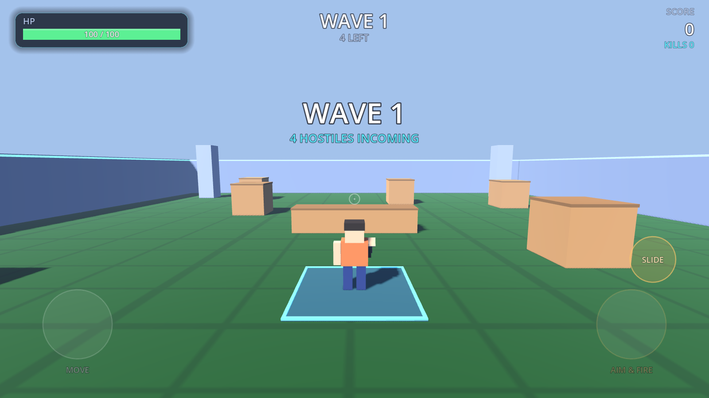
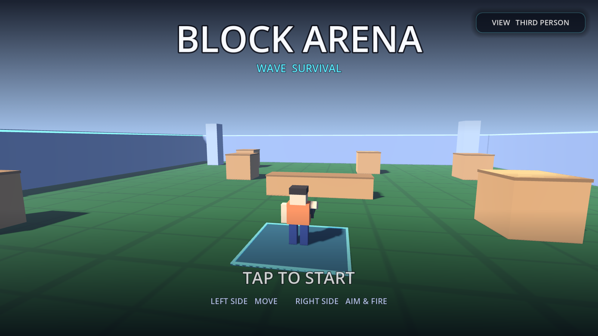
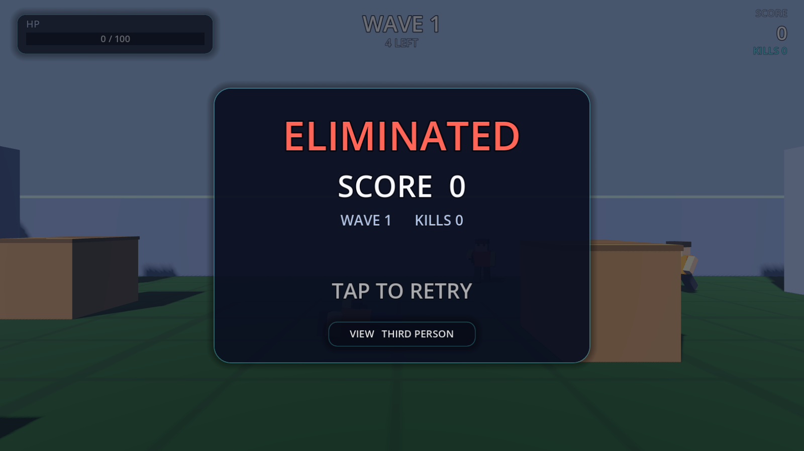
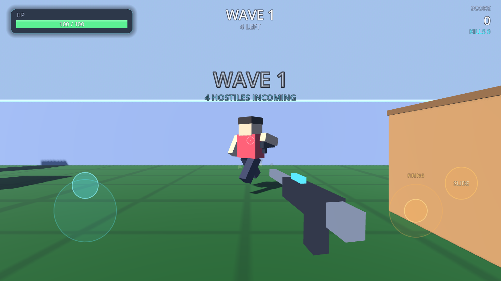
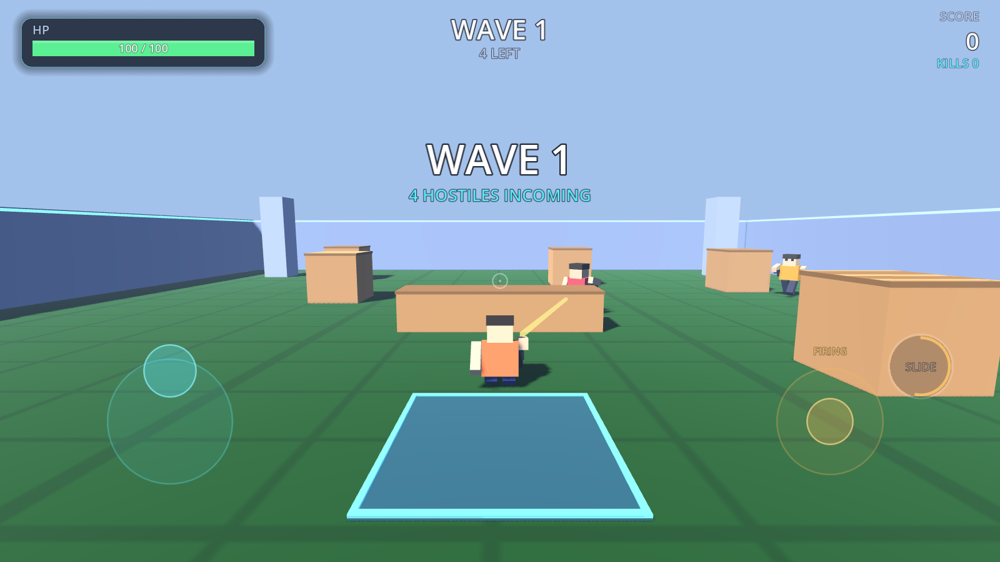

# Block Arena

A blocky wave shooter for Android, built with Godot 4.7. Play it in third person
or flip to first person from the menu. No imported art, models or audio: every
character, prop, texture and sound is generated in code.



## Play

Grab the APK from the [latest-build release](https://github.com/Xphinx-X/block-arena/releases/tag/latest-build)
and install it on an arm64 Android 7.0+ phone. Allow "install from unknown
sources" when prompted. Each CI build has a higher version code, so newer
builds install straight over older ones.

## Controls

| Input | Action |
| --- | --- |
| Left thumb (left half of the screen) | Move |
| Right thumb, drag | Aim the camera **and** fire |
| **SLIDE** button (above the aim stick) | Short forward dash, 1.5 s cooldown |
| **VIEW** pill (title screen / game-over card) | Switch third person ↔ first person |
| Tap | Start / retry |
| Shift (desktop) | Slide |

The crosshair in the middle of the screen is where the bullets go. Shots get a
small auto-aim nudge toward the closest bot inside the cone, so you don't need
pixel-perfect aim on a phone.

The view choice is saved on the device, and can be changed from the title
screen or the game-over card. First person adds a blocky view-model gun and
widens the look-up/down range; third person keeps the spring-arm camera.

The slide is a 0.36 s dash at ~2.4× speed. Use it to break away from a crowd or
dodge a volley; the button dims and refills while it recharges.

## The game

- **Wave survival.** Each wave sends more bots, with more health and speed.
- **Bots fight back.** They close in, keep their distance, strafe and fire
  hitscan shots when they have line of sight.
- **Cover matters.** Crates, pillars and a low centre wall block movement and
  bullets alike.
- **Two views.** Third-person spring-arm camera or a first-person view with a
  procedural weapon model; both share the same aim and auto-aim.
- **Slide.** A quick dash with a cooldown ring on the button.
- **Rewards.** Kills score points, clearing a wave pays a bonus and heals 25 HP.
- **Progress.** Best score, best wave and view preference are saved on the device.



## Project layout

```
main.tscn                  entry scene (one node, script does the rest)
scripts/game.gd            state machine, waves, score, saves, tuning constants
scripts/player.gd          movement, hitscan gun, crosshair convergence, auto-aim, slide
scripts/bot.gd             chase/strafe AI, line-of-sight shooting
scripts/figure.gd          blocky humanoid built from BoxMeshes, swinging limbs, slide pose
scripts/arena.gd           floor, walls, cover, spawn pad
scripts/camera_rig.gd      spring-arm third-person camera + first-person view model
scripts/hud.gd             all UI drawn procedurally (bars, sticks, buttons, cards)
scripts/fx.gd              tracers, muzzle flashes, sparks, death bursts
scripts/sfx.gd             synthesised sound effects
tests/smoke.tscn|gd        headless integration tests
tests/screenshot.tscn|gd   renders PNG screenshots under Xvfb
tools/make_icons.py        generates icon.png + adaptive icon layers
```

Tuning lives in a few constants: `enemies_for_wave()`, `bot_health_for_wave()`
and `bot_speed_for_wave()` in `scripts/game.gd`, `FIRE_INTERVAL`,
`AUTO_AIM_DOT` and `SPEED` in `scripts/player.gd`.

## Building

CI (`.github/workflows/build.yml`) builds a signed debug APK on every push to
`main` and publishes it to the rolling `latest-build` release. Tags (`v1.0`,
`v1.1`, ...) publish a versioned release instead.

Each build is stamped with `version/code = 1000 + run number` and a
`version/name` of `1.0.<run>` (or the tag name without `v`).

Local development with Godot 4.7.2:

```bash
# integration tests (waves, shooting, damage, death, restart, touch handling)
godot --headless --path . res://tests/smoke.tscn

# render screenshots (needs xvfb + mesa)
xvfb-run -a godot --path . --rendering-driver opengl3 \
  --resolution 1600x900 res://tests/screenshot.tscn

# regenerate launcher icons
python3 tools/make_icons.py
```

## Screenshots

| Title | Game over |
| --- | --- |
|  |  |

| First person | Slide |
| --- | --- |
|  |  |

## License

MIT. See [LICENSE](LICENSE).
